# Pratyaksha (प्रत्यक्ष) — AI Video-Analytics System for Monitoring Government Skilling Centres

> **Ministry of Skill Development and Entrepreneurship (MSDE) — Problem Statement 26245**  
> *Privacy-Preserving, Ultra-Low Bandwidth, Automated Rules Engine & Central Monitoring Dashboard*

[](LICENSE)
[]()
[]()
[]()
[]()
[]()
[]()

---

## 1. Executive Summary

**Pratyaksha** (Sanskrit for *"Direct Perception / Verifiable Truth"*) is a comprehensive AI video-analytics platform built to solve the core verification challenge of government skilling schemes (PMKVY 4.0, DDU-GKY, STRIVE, Craftsmen Training). 

Across thousands of training centres, public funds are allocated based on student attendance and sanctioned infrastructure. Pratyaksha provides automated, continuous compliance monitoring **without invasive biometric surveillance, without streaming raw video, and operating stably over rural 2G/3G connections**.

```
                        PRATYAKSHA END-TO-END PIPELINE
                        
 [CCTV Camera]  ──>  [Local Edge Agent]  ──>  [FastAPI Backend]  ──>  [React Dashboard]
  RTSP Stream         - ONNX CPU YOLO          - Automated Rules       - National KPI Map
                      - SQLite WAL Outbox      - Attendance vs SIP     - Alert Triage
                      - Gzip (<245 Bytes)      - Compliance Score      - Privacy Showcase
```

---

## 2. Problem Statement Mapping (5 Expected Outcomes)

The MSDE Problem Statement 26245 defines five critical requirements. Pratyaksha addresses each directly in code:

| MSDE Expected Outcome | Implementation in Pratyaksha | Primary Modules |
| :--- | :--- | :--- |
| **1. Real Attendance Estimation** | Zone-based spatial ROI counting using bottom-center foot-point ground anchors `(x, y2)` to eliminate perspective angle errors; rolling median temporal smoothing ($K=5$) to neutralize student movement and transient occlusions. | [`detector.py`](file:///Users/zaidfaridi/Downloads/PROJECTS%20/Pratyaksha/detector.py), [`zones.py`](file:///Users/zaidfaridi/Downloads/PROJECTS%20/Pratyaksha/zones.py), [`pipeline.py`](file:///Users/zaidfaridi/Downloads/PROJECTS%20/Pratyaksha/pipeline.py) |
| **2. Sanctioned Infrastructure Audit** | Multi-object detection reconciling chairs, workbenches (`dining table`/`bench`), and computers (`laptop`/`monitor`) against sanctioned center quotas; classifies status as `MATCH`, `DEFICIT`, or `SURPLUS`. | [`pipeline.py`](file:///Users/zaidfaridi/Downloads/PROJECTS%20/Pratyaksha/pipeline.py), [`backend/app/rules_engine.py`](file:///Users/zaidfaridi/Downloads/PROJECTS%20/Pratyaksha/backend/app/rules_engine.py) |
| **3. Privacy-Preserving Architecture** | Zero biometric/facial identification; raw video is never stored or uploaded (volatile RAM purged immediately); diagnostic thumbnails are generated strictly upon anomalies, downscaled to $\le 320\text{ px}$ with **all human faces and bodies Gaussian-blurred at the edge**. | [`edge/evidence.py`](file:///Users/zaidfaridi/Downloads/PROJECTS%20/Pratyaksha/edge/evidence.py), [`docs/privacy_design_note.md`](file:///Users/zaidfaridi/Downloads/PROJECTS%20/Pratyaksha/docs/privacy_design_note.md) |
| **4. Low Bandwidth & Poor Hardware Resilience** | Offline-first SQLite WAL outbox queue tolerating prolonged network outages; compact gzip payloads transferred at **245 bytes per sample** (< 1 MB/month); dynamic adaptive throttling across `normal`, `low`, and `ultra_low` profiles; ONNX Runtime CPU inference (**9.2 ms** latency). | [`edge/outbox.py`](file:///Users/zaidfaridi/Downloads/PROJECTS%20/Pratyaksha/edge/outbox.py), [`edge/sync_worker.py`](file:///Users/zaidfaridi/Downloads/PROJECTS%20/Pratyaksha/edge/sync_worker.py), [`edge/adaptive.py`](file:///Users/zaidfaridi/Downloads/PROJECTS%20/Pratyaksha/edge/adaptive.py) |
| **5. Rules Engine & Central Monitoring Dashboard** | Automated compliance evaluator flagging attendance mismatches (<70% of claimed for $K \ge 3$ consecutive windows), missing equipment, camera offline timeouts (15m), and sudden tamper drops ($\ge 80\%$); served through an interactive React + Leaflet + Recharts dashboard with human-in-the-loop alert triage. | [`backend/app/rules_engine.py`](file:///Users/zaidfaridi/Downloads/PROJECTS%20/Pratyaksha/backend/app/rules_engine.py), [`frontend/src/`](file:///Users/zaidfaridi/Downloads/PROJECTS%20/Pratyaksha/frontend/src) |

---

## 3. High-Level Architecture

```mermaid
graph LR
    subgraph Edge["Field Edge Agent (Raspberry Pi / Mini PC)"]
        Cam[RTSP CCTV Feed] --> YOLO[ONNX Runtime CPU]
        YOLO --> Zones[Polygon Zone Manager]
        Zones --> Outbox[(SQLite WAL Outbox)]
        Outbox --> Sync[Gzip Sync Worker]
    end

    subgraph Cloud["Central Monitoring Backend"]
        Sync -->|HTTPS 245B Payload| API[FastAPI Gateway]
        API --> Rules[Automated Rules Engine]
        Rules --> DB[(PostgreSQL / SQLite)]
    end

    subgraph UI["Monitoring Unit Dashboard"]
        DB --> Dashboard[React + Vite + TypeScript]
        Dashboard --> Officer[Scheme Monitoring Officer]
    end
```



---

## 4. Repository Structure

```text
Pratyaksha/
├── demo.py                         # One-click end-to-end demonstration runner
├── docker-compose.yml              # Full-stack container orchestration
├── config.yaml                     # Camera ROI polygons and expected inventory
├── detector.py                     # Phase 1 YOLO detector & privacy blur engine
├── pipeline.py                     # Phase 1 time-sampled detection pipeline
├── zones.py                        # Phase 1 polygon geometry & rolling median smoothing
├── draw_zones.py                   # Phase 1 interactive OpenCV polygon calibration helper
├── sample_data/                    # Multi-zone test video & calibration images
│
├── backend/                        # Phase 2: FastAPI Backend & Automated Rules Engine
│   ├── app/
│   │   ├── main.py                 # FastAPI entrypoint, CORS, routers & startup migrations
│   │   ├── rules_engine.py         # Compliance rules (Attendance, Inventory, Camera, Tamper)
│   │   ├── models.py               # SQLAlchemy ORM models (Centres, Cameras, Events, Alerts)
│   │   ├── schemas.py              # Pydantic validation schemas & telemetry definitions
│   │   └── routers/                # REST endpoints: events, centres, cameras, alerts, dashboard
│   ├── scripts/seed.py             # Realistic national seed data (5 centres across 5 states)
│   └── tests/                      # Automated pytest integration test suite (19 passing)
│
├── frontend/                       # Phase 3: Central React Monitoring Dashboard
│   ├── src/
│   │   ├── pages/                  # Overview, Interactive Map, Alert Queue, Centre Detail, Privacy
│   │   ├── components/             # KPI cards, Leaflet map, Alert triage drawer, Score rings
│   │   ├── api/client.ts           # Central API client with Axios and fallback mockData
│   │   └── context/ThemeContext.py # Dark / Light mode UI context
│   └── vite.config.ts              # Vite dev server with reverse proxy to port 8088
│
├── edge/                           # Phase 4: Low-Bandwidth Edge Agent & Deployment
│   ├── agent.py                    # Resilient edge daemon with auto-reconnect backoff
│   ├── outbox.py                   # Crash-safe SQLite WAL queue & daily byte budget tracker
│   ├── adaptive.py                 # Dynamic CPU/queue monitor with auto-profile throttling
│   ├── schedule_cache.py           # Local batch schedule cache (skips off-hours sampling)
│   ├── detector_runtime.py         # ONNX Runtime (CPU) & PyTorch YOLO inference
│   ├── evidence.py                 # Pre-blurred downscaled evidence thumbnail generator
│   ├── sync_worker.py              # Gzip batch cloud sync worker with exponential backoff
│   ├── export_onnx.py              # YOLO to ONNX export and INT8 quantization utility
│   ├── benchmark.py                # CPU hardware benchmark utility (FPS, latency, RAM)
│   ├── network_simulator.py        # Outage simulation, recovery drain & byte report
│   ├── Dockerfile                  # Slim CPU-only container running as non-root
│   ├── pratyaksha-edge.service     # Hardened systemd service for Raspberry Pi / Mini PC
│   └── tests/                      # Edge test suite (11 passing)
│
├── evaluation/                     # Phase 5: Accuracy Assessment & Benchmarking Suite
│   ├── run_all.py                  # One-command master evaluation runner
│   ├── dataset_generator.py        # Controlled synthetic degradation generator (60 frames)
│   ├── metrics.py                  # Detection MAE/RMSE and Rules Engine Confusion Matrix
│   ├── threshold_sweep.py          # 50%-90% threshold sensitivity sweep & PR curves
│   ├── robustness.py               # Environmental degradations & edge profile evaluation
│   ├── failure_cases.py            # Privacy-blurred failure-case diagnostic gallery
│   ├── REPORT.md                   # Auto-generated comprehensive evaluation report
│   └── charts/                     # Generated high-resolution PNG evaluation figures
│
└── docs/                           # Phase 5: Architecture, Privacy & Field Manuals
    ├── privacy_design_note.md      # Comprehensive Privacy by Design note & DPDPA alignment
    ├── architecture.md             # Multi-tier architecture and sample-to-alert sequence
    ├── deployment_guide.md         # Hardware selection, setup workflows & scaling guide
    ├── user_guide.md               # Scheme Monitoring Officer triage manual
    ├── limitations_and_future_work.md # Honest limits & active learning roadmap
    └── demo_script.md              # 3-minute presentation & live walkthrough narrative
```

---

## 5. Quick Start (Reproducing the Demo)

### Option 1: One-Click Demo Script (Recommended)

```bash
# Activate virtual environment
source .venv/bin/activate

# Execute the master demo script
python demo.py
```
This automatically verifies the backend on port `8088`, validates database seed records, runs live edge detection on the sample video, and opens the React dashboard in your browser.

---

### Option 2: Manual Component Startup

```bash
# Terminal 1: Start Central Backend
cd backend
python -m uvicorn app.main:app --host 0.0.0.0 --port 8088

# Terminal 2: Start Frontend Dashboard
cd frontend
npm run dev -- --port 5188

# Terminal 3: Run Edge Agent (Normal Profile)
python -m edge.agent --config edge/edge_config.yaml --profile normal
```

- **Frontend Dashboard:** [http://localhost:5188](http://localhost:5188)
- **Backend OpenAPI Docs:** [http://localhost:8088/docs](http://localhost:8088/docs)

---

### Option 3: Full-Stack Docker Compose

```bash
docker compose up -d
```

---

### Option 4: Live Video Analytics & On-Demand Stream Demo

Pratyaksha includes an on-demand, privacy-preserving live video streaming monitor that demonstrates real-time edge annotation and instant attendance reconciliation.

1. **Start Backend & Frontend Services:**
   ```bash
   # Terminal 1: Backend with streaming endpoints
   cd backend && python -m uvicorn app.main:app --host 0.0.0.0 --port 8088

   # Terminal 2: React Dashboard
   cd frontend && npm run dev -- --port 5188
   ```

2. **Access the Live Monitor Page:**
   - Open [http://localhost:5188/live](http://localhost:5188/live) in your web browser, or click **"Live Monitor"** in the sidebar.

3. **Key Features to Test in Live Demo:**
   - **Start on Connect / Stop on Disconnect:** The background camera capture and inference worker runs **strictly while a viewer is connected**. The moment you close the tab or switch cameras, the worker halts and frees all hardware capture resources.
   - **Zero Raw Video Storage:** All persons are heavily blurred directly at the edge before encoding. Only anonymized, bounded frames (max 640px, 7.5 FPS) reach the browser.
   - **Interactive Quota Simulator:** Use the claimed quota slider in the top bar:
     - Set claimed attendance to **20**: Current headcount (5) is $25\%$ of quota ($<70\%$ threshold) $\rightarrow$ the progress gauge immediately turns **warning crimson** and a real-time `ATTENDANCE_MISMATCH` alert appears on the live ticker without page refresh.
     - Set claimed attendance to **6**: Current headcount (5) is $83\%$ of quota ($\ge 70\%$) $\rightarrow$ the gauge switches to **compliant emerald green**.
   - **Low-Bandwidth Snapshot Mode:** Click *"Snapshot Mode (7s)"* in the top right to simulate low-bandwidth rural deployments where periodic still frames are polled every 7 seconds instead of a continuous MJPEG stream.
   - **Centre Streaming Policy Flag:** Click *"Centre Privacy Policy"* to toggle live streaming on/off. When turned off, streaming is forbidden by compliance policy with zero video transmission allowed.

4. **Run Streaming & Viewer Lifecycle Tests:**
   ```bash
   pytest backend/tests/test_streaming.py -v
   ```

---

## 6. How to Reproduce Evaluation Results

Pratyaksha strictly enforces **zero fabricated metrics**. All numbers are calculated dynamically from actual model inference and rules engine evaluations with fixed random seeds (`seed=42`).

To re-run the entire Phase 5 evaluation pipeline from scratch:

```bash
python -m evaluation.run_all
```

This single command executes:
1. Generation of 60 controlled test frames across 6 environmental degradation categories (`baseline`, `low_light`, `blur`, `downscaled`, `compression`, `occlusion`).
2. Detection-level MAE, RMSE, and infrastructure precision/recall calculation.
3. Decision-level Rules Engine evaluation across 10 operational compliance scenarios.
4. Threshold sensitivity sweep across 50%–90% attendance ratios and window sizes $K=1\text{--}5$.
5. Extraction and generation of the privacy-blurred failure-case gallery.
6. Export of all metrics to [`evaluation/REPORT.md`](evaluation/REPORT.md) and [`evaluation/results.json`](evaluation/results.json).

### Summary of Live Evaluated Headline Metrics

| Evaluation Dimension | Metric | Evaluated Result | Problem Statement Target | Verdict |
| :--- | :--- | :---: | :---: | :---: |
| **Person Counting Accuracy** | Overall MAE | **0.79 persons** | $< 1.5$ persons | **PASS** |
| **Person Counting Precision** | Overall RMSE | **1.38 persons** | $< 2.0$ persons | **PASS** |
| **Attendance Mismatch Decision** | Precision / Recall / F1 | **1.00 / 1.00 / 1.00** | $> 0.85$ | **PASS** |
| **False Accusation Rate (FPR)** | Attendance False Positive Rate | **0.0%** | $< 5.0\%$ | **PASS** |
| **Missing Equipment Decision** | Precision / Recall / F1 | **1.00 / 1.00 / 1.00** | $> 0.85$ | **PASS** |
| **Edge Payload Footprint** | Compressed Single Sample | **245 Bytes** | $< 2.0\text{ KB}$ | **PASS** |
| **Edge CPU Inference Speed** | ONNX Runtime (`normal` 640px) | **33.4 ms (30.0 FPS)** | $> 10\text{ FPS}$ | **PASS** |
| **Edge CPU Inference Speed** | ONNX Runtime (`ultra_low` 320px) | **9.2 ms (109.3 FPS)** | $> 30\text{ FPS}$ | **PASS** |

---

## 7. Automated Test Suite

Run all 30 unit and integration tests covering the rules engine, API endpoints, SQLite outbox WAL queue, retry backoffs, byte budgets, and adaptive throttling:

```bash
pytest
```
*Result: `30 passed in 1.71s`*

---

## 8. Documentation Index

- 📘 [**Privacy-Preserving Design Note**](docs/privacy_design_note.md) — Detailed privacy architecture, data flow diagrams, threat matrix, and DPDPA 2023 alignment.
- 📐 [**System Architecture & Flow**](docs/architecture.md) — Mermaid architecture models and sample-to-alert sequence diagram.
- 🚀 [**Field Deployment & Scaling Guide**](docs/deployment_guide.md) — Hardware selection, low-bandwidth profiles, systemd service, and 10,000-centre scaling architecture.
- 📋 [**Monitoring Officer User Guide**](docs/user_guide.md) — Dashboard manual and step-by-step alert review and triage procedure.
- 🔬 [**Comprehensive Evaluation Report**](evaluation/REPORT.md) — Quantitative benchmark report with confusion matrices and threshold trade-off curves.
- ⚠️ [**Technical Limitations & Roadmap**](docs/limitations_and_future_work.md) — Honest discussion of environmental limits and active learning future roadmap.
- ⏱️ [**3-Minute Jury Demo Script**](docs/demo_script.md) — Concise presentation narrative and live demo walkthrough.
