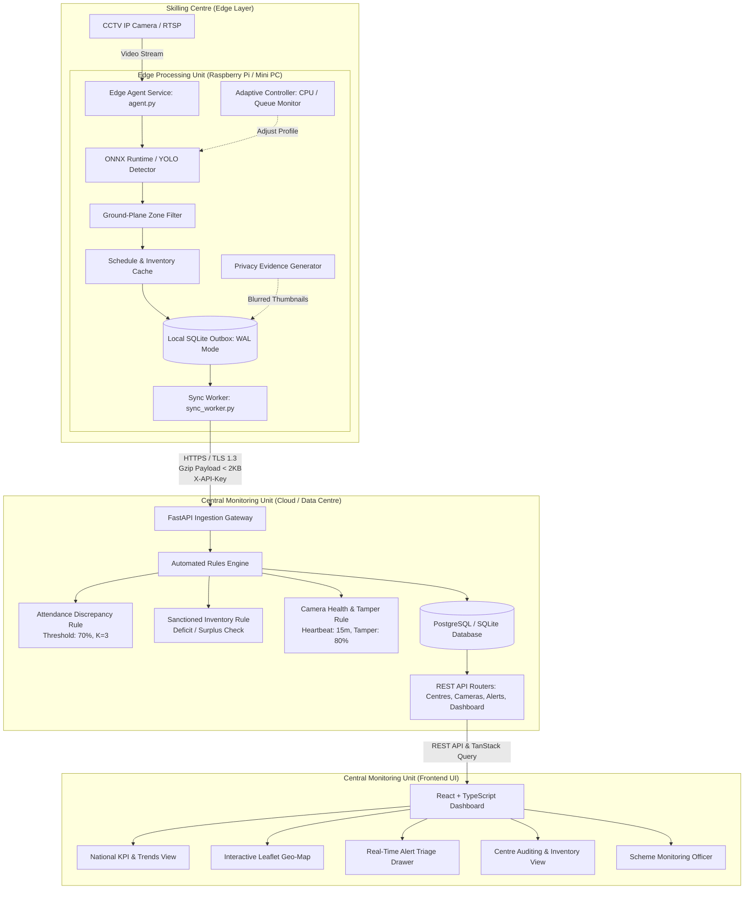
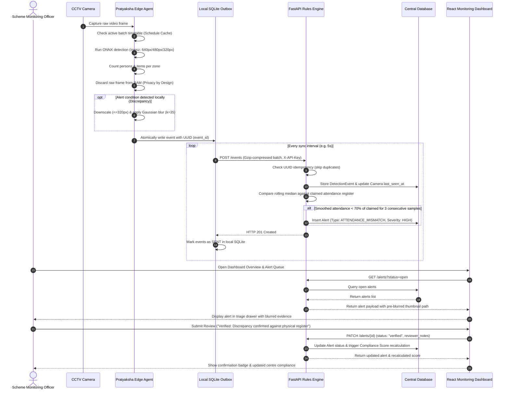

# Pratyaksha System Architecture

This document outlines the end-to-end multi-tier architecture of **Pratyaksha**, encompassing the local edge detection runtime, offline-first sync workers, central FastAPI rules engine, and the React monitoring dashboard.

---

## 1. System Overview

Pratyaksha divides compute responsibilities cleanly between the edge and the cloud:
- **At the Edge (Skilling Centres):** Autonomous, low-bandwidth edge agents process local CCTV RTSP feeds, perform real-time object detection and ground-plane zone filtering, buffer events into a crash-safe local SQLite WAL outbox, and push ultra-compact compressed JSON metadata to the cloud.
- **In the Central Monitoring Unit (MSDE Cloud / State Data Centre):** A high-performance FastAPI backend ingests events, executes the automated compliance rules engine, reconciles claimed physical attendance registers against video evidence, tracks sanctioned inventories, monitors camera health, and serves real-time analytics to the React dashboard.

---

## 2. High-Level Architecture Diagram

---

## 3. End-to-End Sequence Diagram (Sample to Alert to Review Flow)

The following sequence illustrates how a single frame sampled from an edge camera feed triggers an automated attendance violation alert and guides an officer through administrative review:

---

## 4. Key Subsystem Responsibilities

### Edge Agent Subsystem (`/edge`)
- **`agent.py`:** Manages the main resilient capture loop, camera reconnects, and graceful shutdown.
- **`outbox.py`:** Thread-safe SQLite queue utilizing Write-Ahead Logging (WAL) and synchronous normal mode for maximum crash safety.
- **`adaptive.py`:** Background resource sentinel that samples CPU and queue depth via `psutil`, dynamically throttling profiles between `normal`, `low`, and `ultra_low`.
- **`detector_runtime.py`:** Wrapper providing CPU execution provider support with ONNX Runtime alongside native Ultralytics YOLO.
- **`evidence.py`:** Enforces strict privacy guarantees on all diagnostic thumbnail exports.

### Central Backend Subsystem (`/backend`)
- **`app/main.py`:** FastAPI service bootstrap with CORS middleware and OpenAPI specifications.
- **`app/rules_engine.py`:** Deterministic compliance evaluator implementing the 70% attendance ratio, missing sanctioned inventory, camera heartbeat offline timeout (15m), and sudden tamper drop (80%).
- **`app/routers/`:** RESTful modules covering centres, cameras, batches, attendance records, alerts, and dashboard KPI summaries.

### Frontend Dashboard Subsystem (`/frontend`)
- **React 18 + Vite + TypeScript:** High-performance single-page web app.
- **TanStack Query:** Provides optimistic updates, caching, and auto-refetching.
- **Leaflet + OpenStreetMap:** Geographic mapping of skilling centres color-coded by compliance rating.
- **Recharts:** Interactive multi-series trends and alert category breakdowns.
