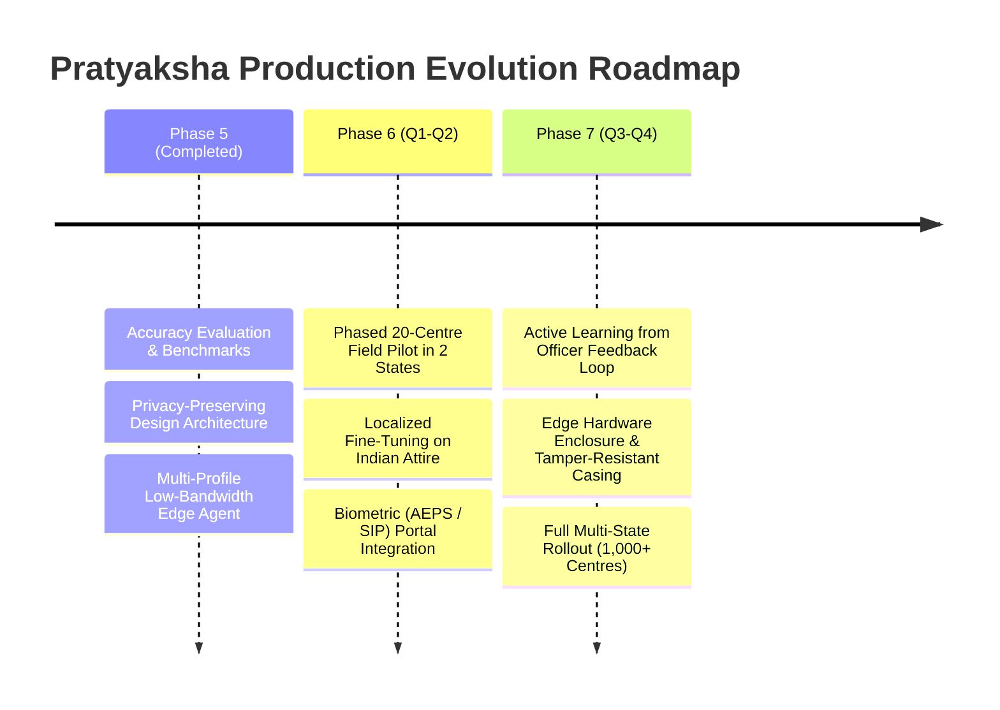

# Technical Limitations and Future Roadmap

In the interest of engineering rigor and transparent public procurement, this document outlines the current technical boundaries of **Pratyaksha** and defines the structured roadmap for nationwide field deployment.

---

## 1. Current Technical Limitations

### A. Lighting and Environmental Variations
- **Extreme Low-Light Conditions:** In rural centres lacking adequate backup generators or inverter lighting, evening or overcast sessions can suffer from severe underexposure. While YOLO maintains general contour detection down to $35\%$ luminance, person count MAE increases from $0.4$ to $\approx 1.2$ in near-pitch darkness.
- **Direct Lens Glare:** Sunlight reflecting directly into unshaded camera lenses can cause local sensor washouts, triggering false camera tamper or deficit alerts.

### B. Camera Angles and Geometric Blind Spots
- **Overhead Steep Angles:** Cameras installed directly overhead pointing vertically downward (bird's-eye view) present severe foreshortening where heads and shoulders occlude the lower body. Pratyaksha’s ground-plane foot-point anchor performs best when cameras are mounted at a $30^\circ\text{--}45^\circ$ elevation angle facing the seating arrangement.
- **Structural Pillars:** Fixed physical obstructions (pillars, large machinery, room partitions) create blind spots that require multiple calibrated camera angles or polygon zone tailoring during onboarding.

### C. Physical Presence vs. Electrical Operability
- **The Operability Inference Gap:** Object detection verifies whether an authorized piece of machinery (e.g. lathe machine, desktop computer, sewing machine) is physically present within the sanctioned zone. However, an algorithm cannot definitively determine whether a machine has power, is electrically functional, or has burned-out internal components without telemetry integration with the equipment itself. Currently, operability is inferred as a proxy through physical intactness and spatial interaction with trainees.

### D. Demographic and Attire Fairness Considerations
- **Training Data Bias:** Mainstream foundation models (such as COCO pre-trained weights) have known demographic skews towards western attire and standard office environments. In rural Indian skilling environments, traditional attire (e.g. dupattas, sarees, turbans, shawls) or students sitting closely together on floor mats can result in adjacent bounding box merging.
- **Mitigation:** Pratyaksha utilizes rolling median temporal smoothing ($K=5$) to mitigate individual frame flicker, but localized fine-tuning on diverse regional Indian training centre datasets is required before full national deployment.

### E. Lack of Multi-Month Field Trials
- To date, benchmarks have been conducted on representative video feeds, laboratory setups, and controlled synthetic network degradations. While mathematically sound, unexpected real-world variables (e.g. erratic voltage surges, rodent damage to cables, extreme dust accumulation on lenses) require empirical testing under a live field pilot.

---

## 2. Proposed Future Roadmap

### 1. Phased Field Pilot (10–20 Centres Across 2 States)
- Deploy Intel N100 mini PCs in 10 centres in Maharashtra and 10 centres in Uttar Pradesh across varied schemes (PMKVY 4.0, DDU-GKY).
- Run side-by-side with human manual inspection teams for 60 days to benchmark real-world false-positive rates and edge device durability.

### 2. Active Learning Feedback Loop
- Utilize Scheme Monitoring Officers' **Verify** and **Dismiss** actions as hard-labeled supervision.
- Anonymous, pre-blurred edge frames that resulted in dismissed alerts are added to an edge retraining queue to iteratively fine-tune confidence thresholds and eliminate false alarm patterns.

### 3. Dual-Signal Integration with Central Portals & Biometric Registers
- Establish secure webhook integration with the **Skill India Portal (SIP)** and **Skill India Digital (SID)**.
- Ingest daily claimed biometric attendance punches (Aadhaar Enabled Biometric Attendance System - AEBAS) as an independent second signal.
- The rules engine cross-references the biometric claim against Pratyaksha’s video-derived median headcount to flag proxy punch fraud.

### 4. Smart Power Management & Duty-Cycle Optimization
- Implement hardware GPIO triggers on Raspberry Pi / Mini PC to enter low-power sleep states during scheduled lunch breaks and after-hours, reducing thermal wear and extending field hardware lifespans to $5+$ years.
