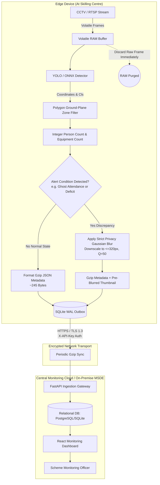

# Privacy-Preserving Design Note

**Project:** Pratyaksha — AI Video-Analytics for Monitoring Government Skilling Centres  
**Problem Statement:** MSDE Problem Statement 26245  
**Version:** 1.0.0 (Phase 5 Release)

---

## 1. Executive Privacy Statement

Pratyaksha was architected from the ground up under the principle of **Privacy by Design**. Unlike commercial biometric CCTV surveillance systems that track and identify individuals, Pratyaksha is strictly an **anonymous census and infrastructure reconciliation engine**.

The core system is mathematically incapable of identifying trainees or trainers. It extracts only spatial numerical headcounts and sanctioned equipment presence, immediately discarding video frames from volatile RAM.

---

## 2. Data Collection Boundary (What Is and Isn't Collected)

| Category | What IS Collected & Transmitted | What IS NOT Collected (Strict Guarantee) |
| :--- | :--- | :--- |
| **Biometrics** | None | **Zero facial recognition**, zero facial embeddings, zero iris/fingerprint scanning. |
| **Personal Identity** | None | **Zero names, Aadhaar numbers, phone numbers, genders, or trainee IDs** extracted from video. |
| **Video Streams** | None | **No raw video footage is ever stored on disk or transmitted over the network.** |
| **Spatial Counts** | Discrete integer counts per zone (e.g. `classroom: 18 persons`). | No individual bounding box trajectories or dwell time tracking per person. |
| **Sanctioned Equipment** | Quantitative status per zone (`chair: 20 expected, 19 detected, DEFICIT`). | No manufacturer serial number OCR or invasive device inspection. |
| **Diagnostic Evidence** | Ultra-low resolution ($320\text{ px}$ wide), heavily blurred diagnostic thumbnails **strictly generated upon alert anomalies**. | No unblurred images, no high-resolution stills, no routine video uploads. |
| **Telemetry** | Edge CPU load, memory utilization, outbox queue depth, agent version. | No local network packet snooping or off-target device data. |

---

## 3. End-to-End Privacy Data Flow Diagram

---

## 4. Evidence Thumbnail Privacy Safeguards

Diagnostic thumbnails are required by scheme monitors to audit why an alert fired (e.g., verifying whether an empty classroom is genuine or an occlusion false alarm). To eliminate re-identification risks:

1. **Pre-Persistence Blurring:** Gaussian blurring ($k \ge 35$) is applied **directly in memory on the edge device** before the thumbnail is written to disk or transmitted. The edge device never writes an unblurred JPEG to its storage.
2. **Extreme Downscaling:** Thumbnails are constrained to a maximum width of $320\text{ px}$ with JPEG quality factor $\approx 50$. Even if digital de-blurring techniques are attempted, high-frequency facial feature details do not exist in the downscaled byte representation.
3. **Anomaly-Gated Trigger:** Thumbnails are never produced during compliant sessions. In normal mode, only metadata is synchronized.
4. **Bandwidth Budget Protection:** When the configurable daily byte limit (e.g. 50 MB) is reached, thumbnail generation is automatically halted, falling back to metadata-only mode.

---

## 5. Retention and Disposal Policy

- **Volatile Raw Frames:** Retained in memory only for the duration of inference (typically $\approx 10\text{--}35\text{ ms}$) and immediately reclaimed by garbage collection.
- **Local Outbox Events (`edge/data/outbox.db`):** Events marked as `SENT` are automatically purged from the edge SQLite database on a rolling basis, keeping at most the last 1,000 sent records to prevent local storage exhaustion.
- **Central Compliance Audit Records:** Aggregated numerical event logs in the central database are retained for **90 days** (configurable via `data_retention_days` in `backend/app/config.py`), following which records are automatically archived or purged.
- **Diagnostic Thumbnails:** Stored on an encrypted object store with an automated lifecycle policy that permanently deletes images after **30 days** of alert closure.

---

## 6. Role-Based Access Control (RBAC)

Pratyaksha defines three administrative personas to restrict data access:

| Role | Access Scope | Permissions |
| :--- | :--- | :--- |
| **National / State Director** | Pan-India / State-wide aggregate analytics | View national KPIs, regional compliance scores, system trends, export CSV summaries. |
| **Scheme Monitoring Officer** | Assigned training centres and active alerts | Review pending discrepancy alerts, inspect pre-blurred anomaly thumbnails, verify or dismiss alerts with written notes. |
| **Centre Administrator / Inspector** | Single training centre | View camera health status, local timetable synchronization, upload physical infrastructure rectification proofs. |

---

## 7. Optional Opt-In Architecture for Identity Tracking Schemes

Certain high-security or direct-benefit transfer (DBT) apprenticeship schemes may legally mandate individual attendance verification. Pratyaksha was designed so that individual identification can **only** exist as an isolated, opt-in layer:

1. **Physical Decoupling:** Biometric identification (e.g. Aadhaar AEPS or 1:1 facial verification) is handled at entry/exit turnstiles via dedicated hardware, **not via ambient CCTV cameras**.
2. **Consent Architecture:** Beneficiaries must sign an explicit, informed consent notice before enrollment.
3. **Pseudonymization:** External biometric IDs are tokenized into cryptographic hashes (`HMAC-SHA256`) before cross-referencing with Pratyaksha’s headcounts.
4. **Immutable Audit Trails:** Any access to beneficiary-linked records requires two-factor authentication (2FA) and is written to an append-only cryptographic audit log.

---

## 8. Threat and Risk Assessment Table

| Threat Scenario | Risk Level | System Safeguards & Mitigations |
| :--- | :---: | :--- |
| **Camera Tampering / Sabotage** | Medium | Automated camera tamper rules engine flags drops $\ge 80\%$ in objects during active class hours. Alerts sent immediately to inspectors. |
| **Re-Identification from Thumbnails** | Low | Hardcoded Gaussian blur ($k=35$) applied at edge before persistence; $320\text{ px}$ downscaling permanently removes micro-facial geometry. |
| **Man-in-the-Middle (MITM) Interception** | Low | All communication over TLS 1.3 (HTTPS) with per-centre secret API key validation (`X-API-Key`). Payload is gzip-compressed binary. |
| **Physical Theft of Edge Device** | Medium | No video footage stored on disk. SQLite outbox contains only numerical JSON counts and blurred thumbnails. Full-disk encryption (LUKS) supported. |
| **False Accusation of Skilling Centre** | Medium | Attendance threshold set to $70\%$ with $K=3$ consecutive window requirement; alerts must be human-verified by monitoring officers before sanction penalties apply. |

---

## 9. Alignment with India's Digital Personal Data Protection Act (DPDPA), 2023

Pratyaksha is **designed to align with** the foundational principles codified in India's **Digital Personal Data Protection Act (DPDPA), 2023**:

1. **Principle of Purpose Limitation (Section 4):** Video analytics is strictly limited to verifying aggregate classroom attendance and equipment reconciliation under sanctioned government schemes.
2. **Principle of Data Minimisation (Section 6):** Only non-identifiable numerical metrics are recorded. Raw biometric and facial attributes are never captured or stored.
3. **Principle of Storage Limitation (Section 8):** Automatic rolling purge of edge outbox records and 90-day retention of cloud audit logs.
4. **Security Safeguards (Section 8(5)):** Strict role-based access, API authentication, and pre-blurring safeguards prevent unauthorized personal data exposure.

---

## 10. Privacy Protections in Enhanced Functional Modules

### A. Ministry-Ready Reports (DPDP Act Aggregate Mandate)
All exported ministerial compliance reports (CSV and PDF) are generated exclusively from high-level, aggregate spatial metrics:
- Attendance is recorded strictly as macroscopic counts (Claimed Headcount vs. Detected Headcount).
- Equipment status is reported as counts per sanctioned category (`operational`, `uncertain`, `non_operational`, `missing`).
- Alert resolution histories document administrative decisions by designated review officers.
- **Statutory Notice:** Every exported document embeds the mandatory legal declaration:  
  *“Generated automatically by Pratyaksha AI Monitoring Engine. All figures are based strictly on aggregate spatial counts with zero biometric or identifiable trainee data in compliance with the Digital Personal Data Protection Act (DPDPA), 2023.”*

### B. Frame Quality Gating & Optical Health Assessment
Quality gating algorithms inspect video quality to prevent distorted footage from triggering erroneous fraud allegations:
- Evaluates four non-biometric pixel statistics: Gaussian blur (Laplacian variance), luminance distribution, standard deviation contrast, and structural scene drift against an empty calibration frame.
- **Zero Facial or Behavioral Processing:** Quality analysis operates strictly over raw matrix pixel values. No facial landmarking, skin-tone analysis, or person-specific features are computed.
- **Unreliable Sample Exclusion:** Unreliable frames are marked `is_reliable = false` and discarded from rule evaluation, safeguarding centres against false punitive actions caused by bad weather, dust, or lighting fluctuations.

### C. Apparent Operability Assessment vs. Worker Surveillance
Equipment operability assessment determines whether sanctioned machines appear ready for training:
- **Macro-Spatial Heuristics Only:** Uses visual indicators such as screen luminance variance on monitor panels, proximity of human foot-points to machinery workspaces, and detection of heavy tarps or clutter blocking chairs or workbenches.
- **No Worker Performance Monitoring:** Pratyaksha does not log individual productivity, keystrokes, facial fatigue, or personal work patterns.
- **Heuristic Disclaimer:** Operability indicators are visual heuristics of apparent readiness and explicitly do not constitute an engineering diagnostic or maintenance certification.
