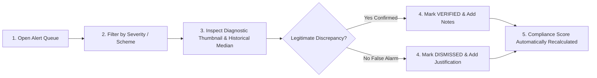

# Pratyaksha Monitoring Officer User Guide

This user guide provides step-by-step operational instructions for Scheme Monitoring Officers, State Nodal Officers, and Central Observers using the Pratyaksha web application.

---

## 1. Overview of the Monitoring Dashboard

The Pratyaksha dashboard provides national, state, and centre-level visibility into compliance across government-funded skilling schemes (PMKVY 4.0, DDU-GKY, STRIVE, Craftsmen Training).

The interface is structured into four primary views:
1. **National Overview:** Top-level KPIs, alert distribution charts, national compliance trends, and latest alert feed.
2. **Interactive Geo-Map:** Geographical map of India showing all registered skilling centres color-coded by real-time compliance score.
3. **Alert Queue:** Centralized triage inbox for reviewing, verifying, or dismissing compliance violations.
4. **Centre Detail View:** Deep-dive audit view for a specific centre, including camera feeds, live headcount vs claimed attendance, sanctioned inventory audits, and historical compliance breakdown.

---

## 2. Navigating the Interface

### Key Metric Indicators (KPI Cards)
- **Total Centres:** Count of registered training centres under observation.
- **Average Compliance Score:** Weighted national compliance rating ($0\text{--}100\%$).
- **Active Open Alerts:** Real-time count of unresolved compliance violations requiring officer review.
- **Attendance Mismatches Today:** Count of sessions where actual headcount fell below 70% of claimed register attendance.
- **Cameras Offline:** Count of camera feeds that have not delivered a heartbeat in $\ge 15$ minutes during active training batch hours.

### Understanding Compliance Scores
- **90% – 100% (Green / Compliant):** Center operates within authorized attendance thresholds and maintains all sanctioned machinery.
- **70% – 89% (Amber / Needs Attention):** Occasional minor attendance deficits or non-critical equipment shortages.
- **< 70% (Red / Non-Compliant):** Critical violations detected (e.g. repeated ghost attendance batches, missing high-value equipment, or prolonged offline cameras).

---

## 3. Step-by-Step Alert Review & Triage Workflow

When an automated rule triggers an alert, it enters the **Alert Queue** in `open` status. Follow this standard operating procedure:

### Step 1: Access the Alert Queue
- Click on **Alert Queue** in the left sidebar navigation.
- Use the quick filters at the top:
  - **Severity:** `CRITICAL`, `HIGH`, `MEDIUM`, `LOW`.
  - **Type:** `ATTENDANCE_MISMATCH`, `INFRASTRUCTURE_GAP`, `CAMERA_OFFLINE`, `CAMERA_TAMPER`.
  - **Status:** Select `open` to see actionable items.

### Step 2: Open Alert Detail Drawer
- Click on any row in the alerts table.
- A sliding triage drawer opens on the right side of the screen displaying:
  - Centre Name, Scheme, and Camera ID.
  - Timestamp of occurrence.
  - Active batch details (claimed headcount vs rolling median detected headcount).
  - Diagnostic pre-blurred evidence thumbnail (if captured).

### Step 3: Review Evidence
- **Check the Rolling Median:** Verify if the deficit was sustained over multiple sampling intervals ($K \ge 3$) rather than a temporary dip.
- **Inspect the Evidence Thumbnail:** Check for visible non-attendance or empty seats.
  *(Note: All individuals are Gaussian-blurred on the edge device to maintain strict privacy).*
- **Cross-Reference Batch Timetable:** Confirm that the alert occurred during sanctioned batch hours.

### Step 4: Adjudicate the Alert
Choose one of the following actions:
1. **Verify (Confirm Violation):**
   - Click the green **Verify Alert** button.
   - Enter your name and mandatory review notes (e.g., *"Verified against biometric punch log; 4 students present vs 25 claimed on SIP portal. Escalated for physical inspection."*).
   - This records the verification in the permanent audit log and deducts points from the centre's compliance rating.
2. **Dismiss (Exonerate / False Positive):**
   - Click the red **Dismiss Alert** button.
   - Enter your justification notes (e.g., *"Dismissed: Approved outdoor practical electrical training session held in courtyard; classroom was legitimately empty."*).
   - The alert is archived without penalizing the centre's compliance score.

---

## 4. Auditing a Training Centre

To audit a specific skilling centre:
1. Navigate to **Centres** in the sidebar.
2. Search by Centre Name, State, District, or Scheme.
3. Click on the centre row to open the full **Centre Detail View**:
   - **Live Attendance Chart:** Visualizes claimed attendance (dashed baseline) vs real-time camera headcounts over time.
   - **Sanctioned Equipment Table:** Lists all sanctioned items per zone, comparing expected inventory against detected counts with status badges (`MATCH`, `DEFICIT`, `SURPLUS`).
   - **Camera Fleet Status:** Shows online/offline status, zone assignments, and last heartbeat timestamps.
   - **Historical Audit Trail:** Complete log of all past alerts, reviewer identities, and resolution notes.
