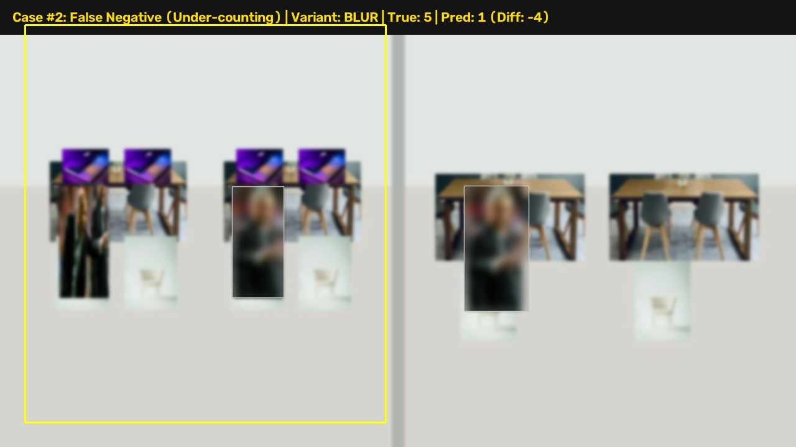
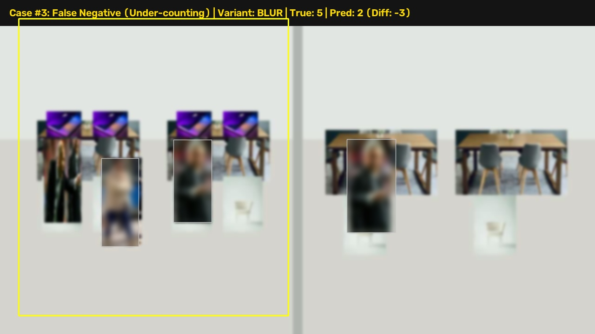
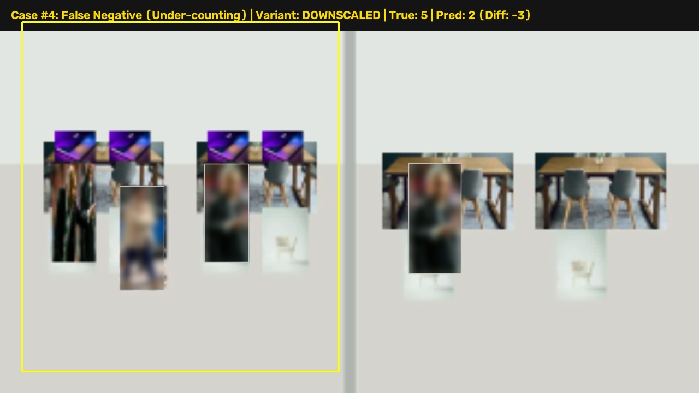

# Pratyaksha Failure-Case Diagnostic Gallery

> **Privacy Guarantee:** All human faces and bodies in this gallery are strictly Gaussian-blurred at the edge before generation. No identifiable individual characteristics are retained.

### CASE_01: False Negative (Under-counting) (Blur)

- **Discrepancy:** Ground Truth = 5 | Model Output = 1 (Error: -4)
- **Root Cause Analysis:** High Gaussian defocus blurred edge boundaries, causing two adjacent seated persons to merge into a single detection candidate.

---

### CASE_02: False Negative (Under-counting) (Blur)

- **Discrepancy:** Ground Truth = 5 | Model Output = 1 (Error: -4)
- **Root Cause Analysis:** High Gaussian defocus blurred edge boundaries, causing two adjacent seated persons to merge into a single detection candidate.

---

### CASE_03: False Negative (Under-counting) (Blur)

- **Discrepancy:** Ground Truth = 5 | Model Output = 2 (Error: -3)
- **Root Cause Analysis:** High Gaussian defocus blurred edge boundaries, causing two adjacent seated persons to merge into a single detection candidate.

---

### CASE_04: False Negative (Under-counting) (Downscaled)

- **Discrepancy:** Ground Truth = 5 | Model Output = 2 (Error: -3)
- **Root Cause Analysis:** Low spatial resolution (320px) caused feature degradation on distant small objects.

---

